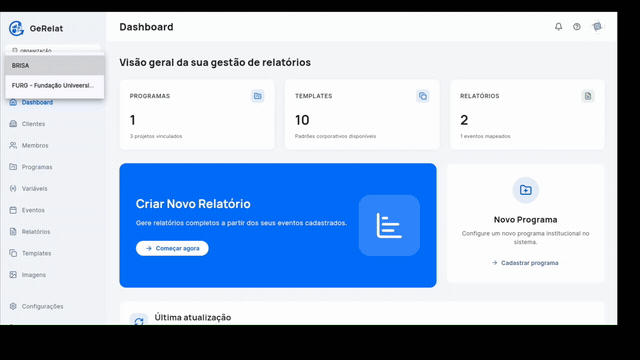
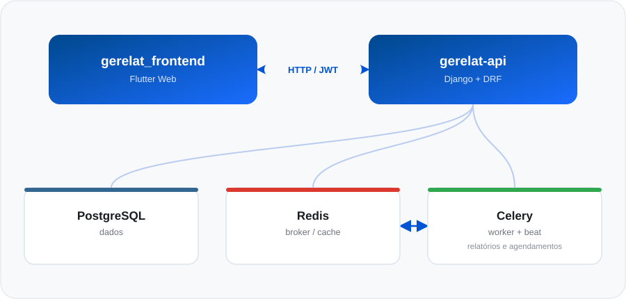

<div align="center">

---

## Demonstração

<div align="center">

</div>

## Sobre o projeto

O GeRelat nasceu para resolver um problema comum em programas institucionais com múltiplos projetos e eventos: consolidar informações espalhadas em planilhas e documentos avulsos em **relatórios padronizados, gerados automaticamente** a partir de dados sempre atualizados.

A plataforma é composta por dois projetos independentes, cada um com seu próprio repositório:


| Projeto       | Repositório                                                              | Stack        |
| --------------- | --------------------------------------------------------------------------- | -------------- |
| Frontend      | [`GeRelat/gerelat_frontend`](https://github.com/GeRelat/gerelat_frontend) | Flutter Web  |
| Backend / API | [`GeRelat/gerelat-api`](https://github.com/GeRelat/gerelat-api)           | Django + DRF |

**Manual do sistema (uso funcional):** [Google Docs](https://docs.google.com/document/d/1FeugSW1jj1xiVCxrHjA0Dy1b18uaKPAg/edit?usp=sharing&ouid=118266443014214060149&rtpof=true&sd=true) · [PDF local](./apresentacao_e_manual/Manual_GeRelat.docx.pdf)

## Funcionalidades

- **Hierarquia flexível** — Cliente → Programa → Projeto → Evento, cada nível com seus próprios campos e permissões.
- **Campos e variáveis dinâmicas** — variáveis de escopo (cliente, programa, projeto) reaproveitadas em qualquer template de relatório.
- **Editor de templates rich-text** — templates de relatório editados diretamente no navegador, com inserção de variáveis e campos do sistema.
- **Geração automática em `.docx`** — o `document_engine` resolve as variáveis e produz o documento final pronto para download.
- **Agendamento de relatórios** — geração recorrente via Celery Beat, sem intervenção manual.
- **Permissões hierárquicas** — `membro_projeto` < `membro_programa` < `admin_cliente` < `admin_gerelat`, com autenticação JWT (access curto + refresh rotativo).
- **Dashboard** com visão geral de programas, templates e relatórios gerados.

## Arquitetura

<div align="center">

</div>

<details>
<summary><strong>Frontend — <code>gerelat_frontend</code></strong></summary>
<br>

- **Stack:** Flutter Web (Dart), sem gerenciador de estado de terceiros — ViewModels próprios via `ChangeNotifier`. Roteamento com `go_router`.
- **Arquitetura:** Clean Architecture em camadas, nomenclatura em português:
  - `lib/dominio/` — entidades e interfaces de repositório.
  - `lib/dados/` — implementações HTTP dos repositórios.
  - `lib/aplicacao/` — ViewModels e composition root (`dependencias.dart`).
  - `lib/nucleo/` — infraestrutura transversal (HTTP client, autenticação, navegação, tema).
  - `lib/paginas/` — telas organizadas por feature (login, clientes, programas, eventos, templates, relatórios, etc.).
- **Autenticação:** JWT com access token de curta duração e refresh token rotativo. O client HTTP (`lib/nucleo/servicos/cliente_http.dart`) deduplica renovações concorrentes e limpa a sessão local quando o refresh falha.

</details>

<details>
<summary><strong>Backend — <code>gerelat-api</code></strong></summary>
<br>

- **Stack:** Django 6 + Django REST Framework, gerenciado com `uv`. PostgreSQL como banco, Redis + Celery (`django-celery-beat`) para tarefas assíncronas e agendamento, `docxtpl`/`python-docx` para geração dos documentos DOCX.
- **Apps:**
  - `apps/accounts` — autenticação (usuário customizado com login por e-mail, JWT via `djangorestframework-simplejwt`).
  - `apps/gerelat` — domínio do sistema: clientes, programas, projetos, campos dinâmicos, eventos, templates, assets, relatórios e agendamentos, além do sistema de permissões hierárquico (`membro_projeto` < `membro_programa` < `admin_cliente` < `admin_gerelat`).
- **Autenticação:** JWT (access token: 30 min; refresh token: 7 dias, com rotação e blacklist). O refresh é responsabilidade do cliente — não há renovação automática no servidor.
- **Geração de relatórios:** o `document_engine/` (dentro de `apps/gerelat`) converte o conteúdo dos templates (formato rich-text estilo ProseMirror, editado no frontend) em documentos `.docx`, resolvendo variáveis de escopo e campos dinâmicos.

</details>

## Como rodar a aplicação completa (ambiente de desenvolvimento)

Pré-requisitos gerais: **Docker** e **Docker Compose**, **Flutter SDK 3.11.5+**, **Git**.

### 1. Clonar os repositórios

```bash
git clone https://github.com/GeRelat/gerelat-api.git
git clone https://github.com/GeRelat/gerelat_frontend.git
```

### 2. Subir o backend (`gerelat-api`)

```bash
cd gerelat-api
cp .env.example .env
docker compose up --build
```

Isso sobe `db` (PostgreSQL), `redis`, roda as migrations, e inicia `web` (API), `worker` e `beat` (Celery) e `flower` (monitoramento).

Criar o usuário administrador inicial:

```bash
docker compose exec web uv run manage.py create_admin --email admin@gerelat.tech --password admin123
```

Endpoints úteis com a API no ar:


| Serviço          | URL                           |
| ------------------- | ------------------------------- |
| API               | http://127.0.0.1:8000/        |
| Django Admin      | http://127.0.0.1:8000/admin/  |
| Swagger / OpenAPI | http://127.0.0.1:8000/docs/   |
| Healthcheck       | http://127.0.0.1:8000/health/ |
| Flower (Celery)   | http://127.0.0.1:5555/        |

> Detalhes de execução local sem Docker (venv, migrations manuais, lint, testes) estão no [README do `gerelat-api`](https://github.com/GeRelat/gerelat-api/blob/main/README.md).

### 3. Subir o frontend (`gerelat_frontend`)

```bash
cd gerelat_frontend
flutter pub get
flutter run -d chrome --dart-define=API_BASE_URL=http://localhost:8000
```

> Sem o `--dart-define=API_BASE_URL=...`, o app aponta por padrão para a API de produção (`https://api.gerelat.tech`) — sempre defina essa variável ao rodar contra o backend local.

O app abre automaticamente no Chrome, autenticado contra a API subida no passo anterior.

## Documentação específica de cada projeto

- [README do `gerelat-api`](https://github.com/GeRelat/gerelat-api/blob/main/README.md) — setup local sem Docker, variáveis de ambiente, migrations, testes, lint e tipagem.
- [README do `gerelat_frontend`](https://github.com/GeRelat/gerelat_frontend/blob/main/README.md) — pré-requisitos do Flutter, estrutura de pastas e design system (paleta de cores e tipografia).

## Manual do sistema

Para o uso funcional da plataforma (fluxos de tela, passo a passo para o usuário final), consulte o manual:

- [Manual de Instruções](https://docs.google.com/document/d/1FeugSW1jj1xiVCxrHjA0Dy1b18uaKPAg/edit?usp=sharing&ouid=118266443014214060149&rtpof=true&sd=true) (Google Docs)
- [Manual de Instruções](./apresentacao_e_manual/Manual_GeRelat.docx.pdf) (PDF local)

---

<div align="center">
